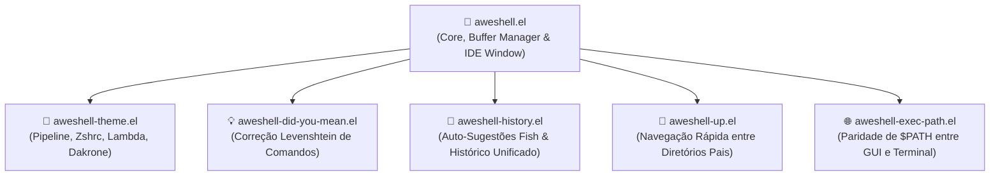

# 🐚 Aweshell — Awesome Eshell

> Extensão avançada, modular e ergonômica para o GNU Emacs Eshell, integrando realce de sintaxe em tempo real, auto-sugestões estilo Fish, temas modernos de prompt e janelas dedicadas estilo IDE.

[](https://github.com/GabrielFrigo4/environment)
[](https://www.gnu.org/software/emacs/)
[](https://kernel.org/)
[](https://freebsd.org/)
[](https://apple.com/)
[-Supported-purple?logo=gitforwindows&logoColor=white>)](https://msys2.org/)
[](https://www.gnu.org/licenses/gpl-3.0)
[](TODO.md)
[](CONTRIBUTING.md)

---

## 🧭 Visão Geral

O **`aweshell`** transforma o shell embutido do Emacs (`Eshell`) em um terminal de primeira classe, aproximando a experiência da agilidade de terminais modernos como Fish e Zsh. Com gerenciamento inteligente de múltiplos buffers, painel retrátil inferior estilo IDE, validação visual de comandos executáveis e correção ortográfica para erros de digitação (_Did You Mean_), o Aweshell entrega velocidade máxima sem dependências pesadas de processos externos.

---

## 🏗️ Arquitetura Modular



---

## ✨ Funcionalidades em Destaque

| Recurso                         | Descrição                                                                                        |
| :------------------------------ | :----------------------------------------------------------------------------------------------- |
| **Sessões Múltiplas**           | Crie, alterne e feche múltiplas sessões com histórico isolado ou compartilhado.                  |
| **Painel Retrátil (IDE)**       | Janela inferior dedicada que abre e fecha instantaneamente via `C-c C-a` ou `aweshell/toggle`.   |
| **Auto-Sugestões Fish/Zsh**     | Ghost-text cinza inline baseado no histórico (`<right>` aceita tudo, `M-f` palavra por palavra). |
| **Menu de Opções Categorizado** | Menu de autocompletar via Company com anotações semânticas (`[alias]`, `[git]`, `[bin]`, etc.).  |
| **Heredocs & Redirecionamento** | Suporte a heredocs interativos (`cat << EOF > out`) e redirecionamento de entrada (`< in`).      |
| **Validação Sintática**         | Feedback visual em tempo real colorindo comandos existentes vs comandos inválidos.               |
| **Did You Mean?**               | Sugestões automáticas baseadas em distância Levenshtein para comandos digitados incorretamente.  |
| **Temas Integrados**            | Paridade 1:1 com os temas do Universal Shell (`multi`, `pill`, `micro`, `zshrc`).                |
| **Aliases Universais**          | Sincronização direta com os aliases do Quarteto (`agyc`, `upall`, `upsh`, `ll`, `e`, `dired`).   |

---

## 🏛️ O Embaixador do Universal Shell no Emacs

O **Aweshell** atua como a camada de projeção e interoperabilidade do [Universal Shell](../../../../Shell) dentro do ecossistema GNU Emacs. O objetivo do módulo é garantir paridade de fluxo de trabalho entre o terminal de sistema e os buffers do Emacs:

- **Paridade Cromática e Tipográfica:** Os temas de prompt (`multi`, `pill`, `micro`) compartilham a mesma geometria de delimitadores e cálculo de largura do Shell UNIX.
- **Ecossistema de Aliases:** Todos os atalhos ergonômicos do [Dicionário de Aliases do Shell](../../../../Shell/docs/ALIASES.md) operam nativamente no Aweshell.
- **Ergonomia Híbrida Lisp:** Comandos de arquivo integram-se diretamente ao ambiente do Emacs (`e` abre em buffer, `ee` em outra janela, `d` abre Dired e `gs`/`magit` gerenciam Git).

### Dicionário de Paridade de Aliases

| Categoria         | Alias Aweshell          | Comando Expandido                       | Papel no Ecossistema                                                           |
| :---------------- | :---------------------- | :-------------------------------------- | :----------------------------------------------------------------------------- |
| **IA CLI**        | `agyc` / `agy-continue` | `agy -c`                                | Retoma a última sessão do Antigravity CLI                                      |
| **IA CLI**        | `agya` / `agyd`         | `agy --dangerously-skip-permissions`    | Executa o agy CLI aprovando ferramentas automaticamente                        |
| **IA CLI**        | `agyca` / `agycd`       | `agy -c --dangerously-skip-permissions` | Retoma sessão com auto-aprovação total                                         |
| **Sincronização** | `upall`                 | `update-all`                            | Atualiza todo o Quarteto (Shell, Profile, Vault, Editores)                     |
| **Sincronização** | `upsh`                  | `update-shell`                          | Atualiza repositório do Shell e recarrega                                      |
| **Sincronização** | `uped`                  | `update-editors`                        | Atualiza suíte de editores e Elisp                                             |
| **Sincronização** | `uprc`                  | `update-profile`                        | Atualiza dotfiles e skills                                                     |
| **Sincronização** | `upmodes`               | `update-emacs-modes`                    | Sincroniza submódulos de modos locais do Emacs                                 |
| **Emacs Buffer**  | `e <alvo>`              | `find-file`                             | Abre arquivo no buffer corrente do Emacs                                       |
| **Emacs Buffer**  | `ee <alvo>`             | `find-file-other-window`                | Abre arquivo dividindo a janela                                                |
| **Emacs Buffer**  | `d` / `dired`           | `dired`                                 | Abre navegação de diretórios Dired                                             |
| **Smart Open**    | `open <alvo>` / `o`     | `emacs/universal-open`                  | Abre texto/código/PDF em buffer; binários externos (Office/mídia) em app do SO |
| **Git**           | `gs`, `ga`, `gc`, `gp`  | `git status`, `add`, etc.               | Ciclo de vida Git idêntico ao terminal                                         |

---

## 🎨 Catálogo de Temas de Prompt

O Aweshell integra temas visuais prontos para uso através de `aweshell-theme`:

| Tema                                             | Características                                                                    |
| :----------------------------------------------- | :--------------------------------------------------------------------------------- |
| **`aweshell/theme-multi`**                       | **(Padrão)** Réplica canônica do prompt Powerline multi-linha do Universal Shell.  |
| **`aweshell/theme-pill`**                        | Estilo cápsula moderno, com auto-adaptação para caracteres ASCII sob Raw TTY.      |
| **`aweshell/theme-micro`**                       | Prompt ultra-minimalista de linha única para máxima densidade vertical.            |
| **`aweshell/theme-theme-zshrc`**                 | Réplica alternativa no estilo Zsh com identificação de OS, data/hora e branch.     |
| **`aweshell/theme-theme-lambda`**                | Prompt minimalista com glifo lambda (`λ`) limpo e foco total na área de digitação. |
| **`aweshell/theme-theme-dakrone`**               | Minimalismo funcional com encurtamento inteligente de diretórios profundos.        |
| **`aweshell/theme-theme-multiline-with-status`** | Multi-linha com exibição de código de retorno e tempo decorrido do último comando. |

Para definir seu tema favorito:

```elisp
(setq aweshell/theme 'aweshell/theme-theme-zshrc)
```

---

## ⌨️ Atalhos & Comandos Interativos

### Navegação e Edição no Shell

|            Tecla            | Comando                        | Ação                                                      |
| :-------------------------: | :----------------------------- | :-------------------------------------------------------- |
|          **`C-l`**          | `aweshell/clear-buffer`        | Limpa o buffer atual preservando o histórico              |
|         **`C-S-l`**         | `aweshell/sudo-toggle`         | Alterna ou insere `sudo` no início do comando atual       |
|          **`M-'`**          | `aweshell/search-history`      | Busca interativa de comandos anteriores                   |
|  **`<right>`** / **`C-f`**  | `aweshell/suggest-accept`      | Aceita a sugestão inline completa ou seleciona no Company |
| **`M-f`** / **`C-<right>`** | `aweshell/suggest-accept-word` | Aceita a próxima palavra da sugestão inline (Fish/Zsh)    |
|   **`C-e`** / **`<end>`**   | `aweshell/suggest-accept-end`  | Aceita sugestão completa e salta para o fim da linha      |
|        **`C-c C-c`**        | `aweshell/cancel-heredoc`      | Cancela sessão de heredoc interativo ativa                |
|          **`M-h`**          | `aweshell/suggest-accept`      | Atalho alternativo para aceitar a sugestão de histórico   |

### Gestão de Buffers e Janelas

| Comando                      | Ação                                                 |
| :--------------------------- | :--------------------------------------------------- |
| **`aweshell/new`**           | Abre uma nova sessão numerada independente do Eshell |
| **`aweshell/toggle`**        | Abre ou fecha o painel dedicado inferior estilo IDE  |
| **`aweshell/next`**          | Salta para a próxima sessão ativa do Aweshell        |
| **`aweshell/prev`**          | Salta para a sessão anterior do Aweshell             |
| **`aweshell/switch-buffer`** | Menu interativo de seleção de sessões ativas         |

### Lançadores Globais de Aplicativos (`C-c o`)

| Atalho                        | Comando                   | Ação                                                                             |
| :---------------------------- | :------------------------ | :------------------------------------------------------------------------------- |
| **`C-c o o`** / **`C-c o f`** | `emacs/universal-open`    | Smart Open: texto/código/PDF em buffer, binários (Office/mídia) em apps externos |
| **`C-c o b`**                 | `emacs/open-browser`      | Abre o navegador padrão do sistema                                               |
| **`C-c o w`**                 | `emacs/open-office`       | Abre a suíte office (LibreOffice, OnlyOffice, Collabora)                         |
| **`C-c o d`**                 | `emacs/open-file-manager` | Abre a pasta atual no gerenciador de arquivos gráfico do sistema                 |
| **`C-c o t`**                 | `emacs/open-terminal`     | Abre terminal externo dedicado (`foot` ou `xterm`) no diretório                  |
| **`C-c o a`**                 | `aweshell/new`            | Dispara uma nova sessão numerada do Aweshell                                     |

---

## 🚀 Instalação

### Modo Local / Git Submodule (Recomendado no Ecossistema)

Se você utiliza o **Universal Environment** ou o **GNU Emacs Hub**:

```sh
# Dentro do diretório ~/.emacs.d/usr/local/
git submodule add https://github.com/GabrielFrigo4/aweshell.git usr/local/aweshell
```

No seu `init.el`:

```elisp
(add-to-list 'load-path (expand-file-name "usr/local/aweshell" user-emacs-directory))
(require 'aweshell)
```

---

### Via Elpaca

```elisp
(use-package aweshell
  :ensure (:type git :host github :repo "GabrielFrigo4/aweshell")
  :commands (aweshell/new aweshell/toggle aweshell/dedicated-toggle))
```

---

### Via Quelpa

```elisp
(use-package aweshell
  :quelpa (aweshell :fetcher github :repo "GabrielFrigo4/aweshell")
  :commands (aweshell/new aweshell/toggle))
```

---

## ⚙️ Configuração Recomendada

```elisp
(use-package aweshell
  :ensure nil
  :commands (aweshell/new aweshell/toggle aweshell/dedicated-toggle aweshell/switch-buffer)
  :init
  (defalias 'esh 'aweshell/new)
  (defalias 'eshell 'aweshell/new)
  (setq-default aweshell/validate-executable nil)
  (setq-default aweshell/auto-suggestion-p t)
  (setq-default aweshell/banner-message "Welcome to the Awesome Emacs Shell\n")
  :config
  (setq aweshell/theme 'aweshell/theme-theme-zshrc))
```

---

## 🛠️ Automação & Quality Gates

O repositório possui uma interface de compilação e teste estrita compatível com GNU e BSD Make:

```sh
# Validar sintaxe e integridade em modo batch do Emacs
make test
# ou via script unificado:
./aweshell.sh test

# Compilar bytecode (.elc)
make compile

# Limpar artefatos gerados
make clean

# Diagnóstico de ambiente e utilitários
./aweshell.sh doctor
```

---

## 🚀 Setup do Projeto & Ganchos Git

> 🤝 **Guia de Contribuição:** [CONTRIBUTING.md](CONTRIBUTING.md)

Após clonar o repositório, execute o comando abaixo para ativar os quality gates locais (pre-commit, commit-msg):

```sh
make hooks
```

Para validar integridade, compilar e rodar a suíte completa de CI localmente:

```sh
make test    # Validação batch de todos os .el
make ci      # Pipeline completo (test + compile + clean)
```

---

## 📄 Licença & Créditos

- **Autor Original:** Andy Stewart (`lazycat.manatee@gmail.com`)
- **Mantenedor Atual:** [Gabriel Frigo](https://github.com/GabrielFrigo4)
- **Licença:** GNU General Public License v3.0 — Consulte o arquivo [LICENSE](LICENSE) para mais informações.
