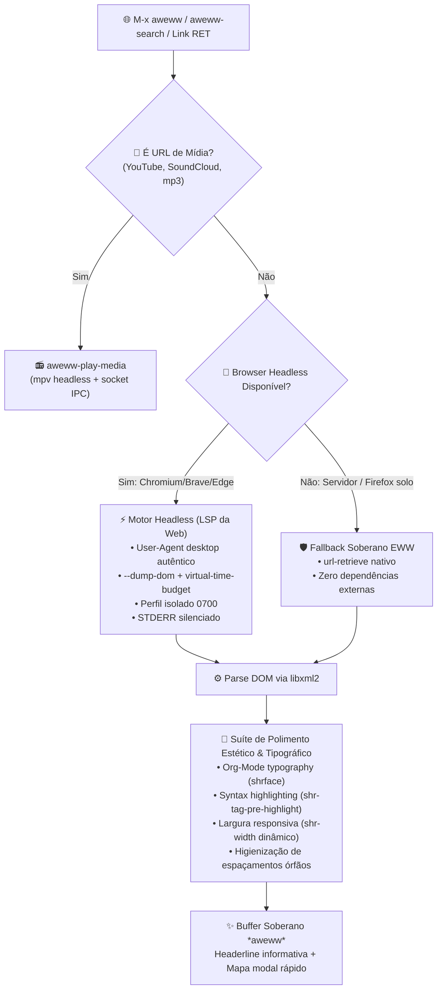

# 🌐 Aweww — Awesome EWW

> Extensão moderna, tipográfica e ergonômica para o navegador embutido Emacs Web Wowser (EWW), transformando o GNU Emacs em uma estação de leitura imersiva e sem distrações.

[](https://github.com/GabrielFrigo4/environment)
[](https://www.gnu.org/software/emacs/)
[](https://www.gnu.org/software/emacs/manual/html_node/eww/index.html)
[](aweww.el)
[](LICENSE)
[](TODO.md)
[](CONTRIBUTING.md)

---

## 🧭 Visão Geral

O **`aweww`** (Awesome EWW) eleva a experiência nativa do navegador `eww` do GNU Emacs para o paradigma inovador de **"LSP da Web" sob Arquitetura Dual-Engine**:

1. **Motor Headless Turbo (LSP da Web):** Quando navegadores com suporte nativo a `--dump-dom` (Chromium, Chrome, Brave, Edge) estão disponíveis, o Aweww orquestra uma execução efêmera, injeta um `User-Agent` autêntico de desktop para contornar verificações anti-bot e recolhe o DOM 100% hidratado com JavaScript executado.
2. **Fallback Soberano Nativo:** Se nenhum navegador externo estiver instalado no sistema, o Aweww decai graciosamente e de forma resiliente para o `url-retrieve` nativo do Emacs, preservando todas as melhorias tipográficas, larguras dinâmicas, syntax highlighting em blocos de código e interceptação de mídia para `mpv`.
3. **Ponte Gráfica Externa (`O`):** Permite despachar com um único toque a URL da página atual para o seu **Firefox gráfico** caso necessite de interações complexas, logins OAuth ou extensões.

---

## 🔄 Fluxo de Renderização & Interceptação



---

## ✨ Funcionalidades em Destaque

| Recurso                                | Descrição                                                                                    |
| :------------------------------------- | :------------------------------------------------------------------------------------------- |
| **LSP da Web (Hidratação DOM)**        | Executa páginas modernas com JS via navegador headless e renderiza o DOM no `shr`.           |
| **Centralização Imersiva (Margens)**   | Centralização visual elegante e margens calculadas (`aweww-content-width`) tipo revista.     |
| **Catálogo Estruturado do YouTube**    | Busca no YouTube (`y`) parseia dados reais e exibe cards limpos com reprodução via MPV.      |
| **Player Card Interativo para MPV**    | Exibe cartão de reprodução limpo no buffer com comandos instantâneos de pausa e volume.      |
| **Headerline Sincrônica & Sem Emojis** | Barra superior tipográfica com divisores vetoriais (`│`) e atalhos alinhados à direita.      |
| **Antifragilidade no Google**          | Roteamento adaptativo de User-Agent moderno para contornar reCAPTCHAs e bloqueios no Google. |
| **Matriz Multiplataforma por SO**      | Resolução inteligente em cascata por SO (Linux, FreeBSD/OpenBSD, macOS, Windows).            |
| **Pesquisa Integrada (`s`)**           | Busca no DuckDuckGo, Google ou SearXNG com JS hidratado e sem bloqueios de robô.             |
| **Histórico com Cache em Memória**     | Navegação instantânea para trás (`B`) e para frente (`F`) reaproveitando o DOM em cache.     |
| **Ponte Gráfica Externa (`O`)**        | Abre a URL atual no Firefox gráfico completo com um único toque.                             |
| **Perfil Efêmero Isolado**             | Execução headless em diretório temporário isolado (`0700`) sem conflito com GUI.             |
| **Player Headless MPV com IPC**        | Intercepta YouTube e áudio para reprodução assíncrona leve via `mpv` com zero zumbis.        |
| **Leitura Imersiva (Readable)**        | Alternância bidirecional entre artigo limpo e página completa na tecla `R`.                  |
| **Controle Instantâneo de Mídia**      | Alterne renderização de imagens (`I`) ou cores CSS (`C`) para economia de recursos.          |
| **Sintaxe em Blocos de Código**        | Integração pronta com `shr-tag-pre-highlight` para realce de trechos `<pre>`.                |
| **Tipografia Org-Mode**                | Suporte transparente a `shrface` para cabeçalhos e títulos visualmente estruturados.         |
| **Ferramenta de Diagnóstico**          | Comando interativo `M-x aweww-doctor` e CLI `sh aweww.sh doctor`.                            |

---

## ⌨️ Mapa de Teclas & Comandos Modais

Ao navegar no buffer dedicado `*aweww*`, as teclas rápidas operam diretamente sem prefixos complexos:

|     Tecla     | Comando                          | Ação                                                                   |
| :-----------: | :------------------------------- | :--------------------------------------------------------------------- |
|   **`RET`**   | `aweww-follow-link`              | Segue o link sob o cursor mantendo a hidratação do Aweww (ou toca MPV) |
|    **`s`**    | `aweww-search`                   | Pesquisa termos na web via mecanismo configurado (DuckDuckGo/Google)   |
|    **`y`**    | `aweww-youtube-search`           | Pesquisa vídeos no YouTube com catálogo estruturado e MPV              |
|   **`M-c`**   | `aweww-toggle-centering`         | Alterna centralização e margens inteligentes no buffer                 |
|    **`o`**    | `aweww`                          | Abre nova URL ou termo de pesquisa                                     |
| **`r` / `g`** | `aweww-reload`                   | Recarrega a página ativa com nova hidratação                           |
|    **`R`**    | `aweww-toggle-readable`          | Alterna modo de leitura sem distrações (_Reader View_)                 |
|    **`O`**    | `aweww-open-in-external-browser` | Abre a página atual no navegador externo gráfico (ex: Firefox)         |
|    **`D`**    | `aweww-hydrate-current-buffer`   | Força re-hidratação via motor headless                                 |
|    **`w`**    | `aweww-copy-page-url`            | Copia a URL da página ativa para a área de transferência               |
|    **`B`**    | `aweww-back-url`                 | Retorna à página anterior no histórico (instantâneo via cache)         |
|    **`F`**    | `aweww-forward-url`              | Avança à página seguinte no histórico (instantâneo via cache)          |
|    **`H`**    | `eww-list-histories`             | Exibe histórico navegacional completo                                  |
|    **`I`**    | `aweww/toggle-images`            | Liga/Desliga exibição de imagens na página                             |
|    **`C`**    | `aweww/toggle-colors`            | Liga/Desliga cores e estilos CSS originais                             |
|    **`P`**    | `aweww-mpv-toggle-pause`         | Alterna pausa do fluxo ativo no `mpv`                                  |
|    **`X`**    | `aweww-mpv-stop`                 | Encerra reprodução no `mpv` e remove sockets IPC                       |
|    **`+`**    | `aweww-mpv-volume-up`            | Aumenta volume do player em 5%                                         |
|    **`-`**    | `aweww-mpv-volume-down`          | Diminui volume do player em 5%                                         |
|    **`>`**    | `aweww-mpv-seek-forward`         | Avança 10 segundos no fluxo multimídia                                 |
|    **`<`**    | `aweww-mpv-seek-backward`        | Retrocede 10 segundos no fluxo multimídia                              |
|    **`q`**    | `quit-window`                    | Fecha a janela do navegador graciosamente                              |

---

## 🚀 Instalação & Uso

### No Ecossistema Universal Environment / GNU Emacs Hub

O componente já vem integrado na suíte de aplicativos sob `Editor/Emacs/usr/local/aweww/`.

Para iniciar a navegação interativa:

```text
M-x aweww
```

Para realizar uma pesquisa direta:

```text
M-x aweww-search
```

Para verificar o status do ambiente e navegadores detectados:

```text
M-x aweww-doctor
```

---

## ⚙️ Configuração Personalizada

O `aweww` possui variáveis declarativas customizáveis via `M-x customize-group aweww`:

```elisp
(use-package aweww
  :ensure nil
  :commands (aweww aweww-search aweww-doctor)
  :config
  ;; Motor de busca padrão ('duckduckgo, 'google, 'searxng)
  (setq aweww-search-engine 'duckduckgo)

  ;; Estratégia de resolução ('auto, 'chromium-only, 'custom-list)
  (setq aweww-browser-strategy 'auto)

  ;; Tempo limite concedido ao JS para hidratação (ms)
  (setq aweww-virtual-time-budget 2500)

  ;; Margem dinâmica das bordas da janela
  (setq aweww/default-width-offset 8)

  ;; Interceptação de mídia leve para mpv
  (setq aweww-intercept-media t))
```

---

## 🔍 Diagnóstico do Ambiente (CLI)

Você pode verificar a saúde do componente diretamente pelo terminal:

```sh
sh Editor/Emacs/usr/local/aweww/aweww.sh doctor
```

Para rodar a suíte completa de testes sintáticos:

```sh
sh Editor/Emacs/usr/local/aweww/aweww.sh test
```

---

## 📄 Licença & Créditos

- **Autor & Mantenedor:** [Gabriel Frigo](https://github.com/GabrielFrigo4)
- **Licença:** MIT License — Consulte o arquivo [LICENSE](LICENSE) para detalhes completos.
